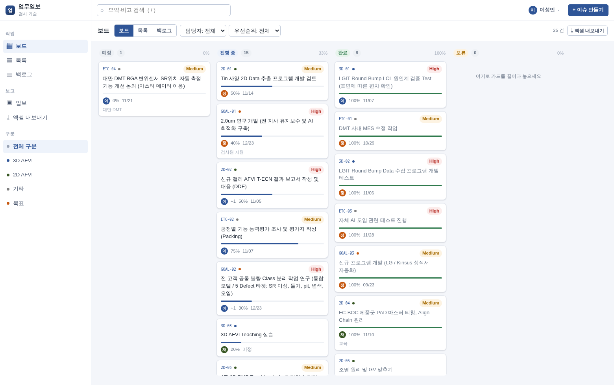
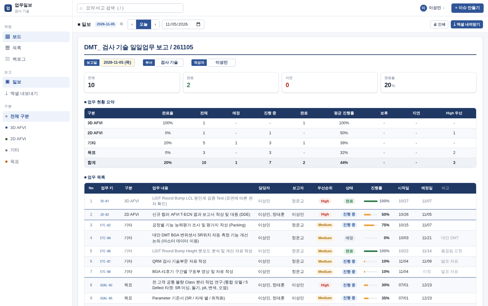

# 업무일보 — work-report

A Jira-shaped collaborative work tracker that exports **the team's existing Excel
daily report, cell for cell**. The workbook everyone already uses stays the output
format; the input becomes a board, a list, a backlog and an issue drawer that
several people can work in at the same time.

- **Korean by default.** The UI copy is written the way the team speaks, not
  translated from English. `en` and `ja` are available.
- **The spreadsheet is a contract, not an export.** Column widths, merged ranges,
  hairline borders, number formats, conditional formatting, dropdown validations
  and the summary formulas are all reproduced and asserted by
  `tests/Feature/ExcelExportGoldenTest.php`.
- **Laravel 13 + PostgreSQL 18 + PhpSpreadsheet 5**, one container, no build step.

```
업무일보 보드   →  일보 그리드  →  업무일보_YYYYMMDD.xlsx
 (칸반 · 목록)      (양식 그대로)      (rev02 서식 1:1)
```

| 보드 | 일보 |
|---|---|
|  |  |

**Production**: <https://egg.tail9f7f1f.ts.net/report> (tailnet only) — board 0.09 s,
Excel export 0.30 s, PostgreSQL on the same host.

## Quick start

```sh
cp .env.example .env
php artisan key:generate
# fill in DB_* (PostgreSQL — see docs/deploy.md for the container recipe), then:
php artisan migrate --seed
php artisan serve
```

Open <http://127.0.0.1:8000/board> (locally the mount prefix is empty; with
`WR_BASE_PATH=/report` every generated URL carries it).

No PHP on the host? Run everything in the dev image:

```sh
podman build -f deploy/Containerfile -t localhost/work-report:current .
deploy/scripts/install.sh
```

Full deployment (Podman + Quadlet + `tailscale serve /report`) is in
[docs/deploy.md](docs/deploy.md).

## What is in the box

| Surface | Route | Purpose |
|---|---|---|
| Board | `/report/board` | Kanban with drag & drop across 예정 / 진행 중 / 완료 / 보류 |
| List | `/report/list` | The workbook's columns as a dense sortable table |
| Backlog | `/report/backlog` | Everything grouped by 구분 |
| Issue drawer | `/report/issues/{id}` | Inline edit, comments, `@mentions`, activity timeline |
| 일보 | `/report/daily` | The printed sheet, generated from live data |
| Export | `/report/export.xlsx` | The real thing: rev02 layout, `업무일보_YYYYMMDD.xlsx` |

Keyboard: `c` new issue · `/` search · `g b` board · `g l` list · `g d` daily · `Esc` close.

## Architecture

```
app/
  Contracts/ActorResolver.php        ← the only seam for identity
  Services/OidcActorResolver.php     ← the implementation: SSO claims → member
  Support/Markdown.php               ← the only Markdown renderer (league/commonmark)
  Services/IssueKeyGenerator.php     ← atomic per-project numbering (3D-01)
  Services/Excel/
    ReportSheetWriter.php            ← sheet 업무일보, every colour and formula
    WorkbookWriter.php               ← three sheets, defined names, order
    ReportExporter.php               ← filters → workbook + filename
    XlsxPackager.php                 ← post-write XML repairs (see below)
  Http/Controllers/                  ← Board, Issue, DailyReport, Export
resources/views/                     ← Blade + Alpine, hand-written CSS
lang/ko/{ui,activity}.php            ← Korean is the source language
docs/excel-schema.md                 ← the golden spec, extracted from the file
tools/inspect_xlsx.py                ← regenerates that spec from any workbook
```

### Two details worth knowing

**`XlsxPackager` exists for a reason.** PhpSpreadsheet writes `_xlfn.AVERAGEIFS`
(the function-name prefix Excel uses for post-2007 functions), but the reference
workbook contains plain `AVERAGEIFS` — and LibreOffice rejects the prefixed form.
It also writes only `fgColor` for solid fills, which renders black in readers that
honour `bgColor`. Both are repaired by rewriting the produced archive, so
everything else stays exactly as the writer emitted it.

**Issue keys are allocated, never derived.** The workbook computes `업무 키` with
`=COUNTIFS($D$16:$D16,$D16,$E$16:$E16,"<>")`, which renumbers when a row is
inserted. People quote keys in comments, so the number is reserved once inside the
insert transaction (`IssueKeyGenerator`) and kept in a project counter that survives
deletions.

## Development

```sh
composer test            # phpunit, PostgreSQL (jsonb is real)
composer lint            # pint --test
composer fix             # pint
python3 tools/inspect_xlsx.py docs/source-rev02.xlsx   # re-extract the spec
```

Tests need a PostgreSQL. Point them at a **separate local** instance, never at the
production one: the suite drops and recreates its schema.

```sh
podman run -d --name wr-pg-test -p 127.0.0.1:5442:5432 \
  -e POSTGRES_DB=work_report_test -e POSTGRES_USER=work_report -e POSTGRES_PASSWORD=secret \
  docker.io/library/postgres:18-alpine
podman exec wr-pg-test psql -U work_report -d work_report_test \
  -c 'CREATE EXTENSION IF NOT EXISTS pg_trgm'

DB_HOST=127.0.0.1 DB_PORT=5442 DB_PASSWORD=secret DB_SSLMODE=prefer composer test
```

The test suite asserts the exporter against `docs/source-rev02.xlsx` itself:
sheet order, column widths, merged ranges, every written cell, the hidden
`집계용 진행률` helper column, the six dropdown ranges, the conditional-format
blocks and the print setup.

## Identity and SSO

Sign-in is the authorization center at <https://521985.xyz/sso>; there are no
passwords in this application. `App\Contracts\ActorResolver` is the single place
that decides who is acting, and `OidcActorResolver` is its only implementation: a
session carrying OIDC claims → a `members` row keyed by `oidc_issuer`+`oidc_subject`
(enrolled on first sign-in). Controllers, views, policies and the schema never see a
token. See [docs/auth-seam.md](docs/auth-seam.md).

## Markdown

Descriptions and comments are stored as Markdown and rendered on the way out by
`App\Support\Markdown` — `league/commonmark`, GitHub dialect, raw HTML escaped,
`javascript:` links dropped, `@name` highlighted through a proper node renderer
rather than a regex. The editor is EasyMDE, vendored under
`public/assets/vendor/easymde` together with the Font Awesome solid icons it needs;
its preview pane calls `POST /markdown`, so the preview is the saved output rather
than a second, differently-behaved client-side parser.

## Real-time editing

Documents are edited together: Yjs merges keystrokes in a room per document, the
application's autosave persists the merged text with a revision, and a signed token
(issued after the usual permission check) is what lets a browser join. The sync
service is its own container (`work-report-collab`, loopback only, proxied at
`/collab/`). See [docs/documents.md](docs/documents.md).

## Docs

- [docs/excel-schema.md](docs/excel-schema.md) — the workbook, extracted and specified
- [docs/architecture.md](docs/architecture.md) — how the pieces fit
- [docs/deploy.md](docs/deploy.md) — Podman, Quadlet, `/report` reverse proxy
- [docs/replication.md](docs/replication.md) — standby copy on the AI host, and the no-restart fallbacks
- [docs/design-system.md](docs/design-system.md) — the shared visual paradigm (`wr-theme`) every app copies
- [docs/auth-seam.md](docs/auth-seam.md) — the OIDC integration point
- [docs/ui.md](docs/ui.md) — interaction model and design tokens

## License

MIT
